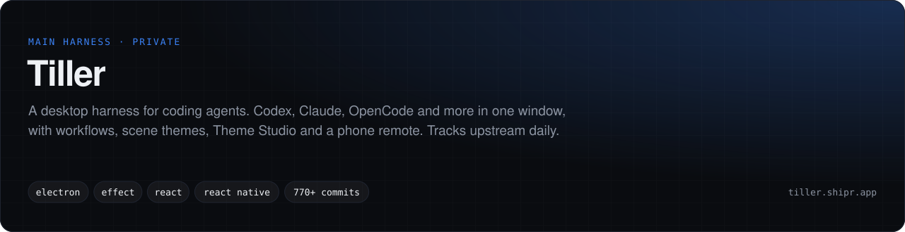
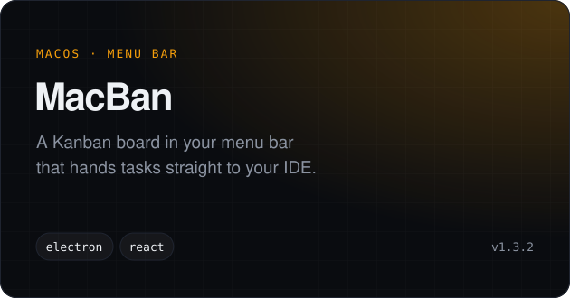
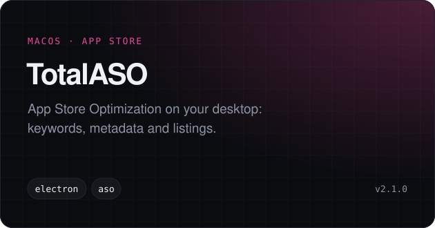
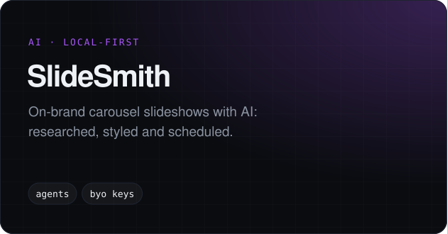
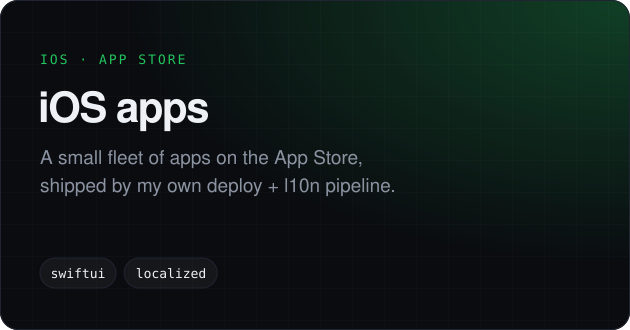
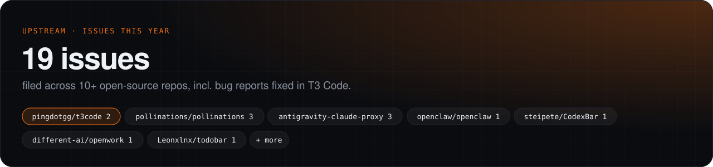

  

  <a href="https://hammaadjamshed.com/">hammaadjamshed.com</a> ·
  <a href="https://tiller.shipr.app">tiller.shipr.app</a> ·
  <a href="https://x.com/hammaadjam">@hammaadjam</a>

  

  

  
  

  
  

  

  

