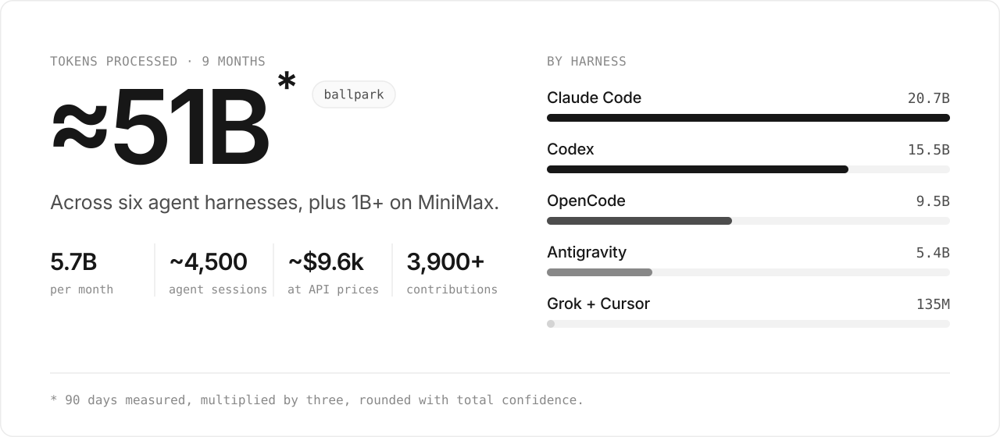
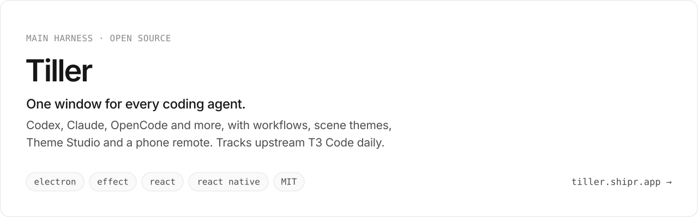
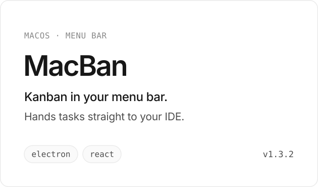
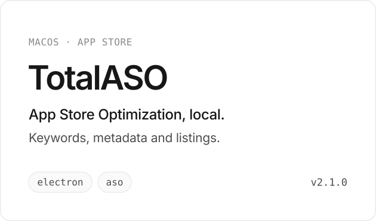
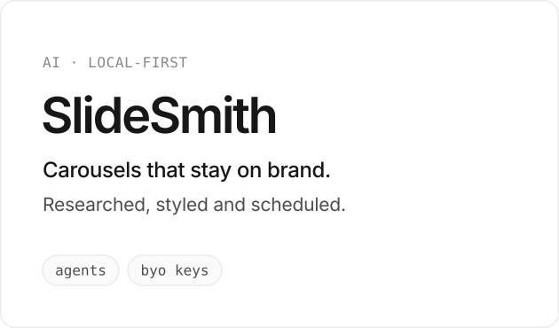
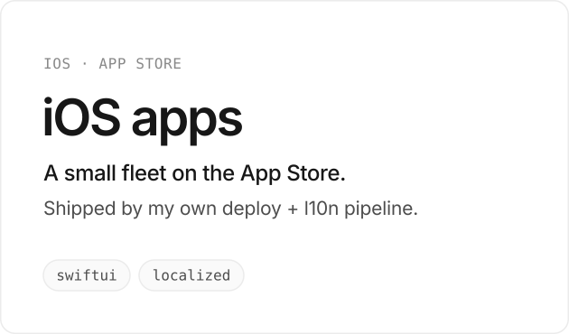
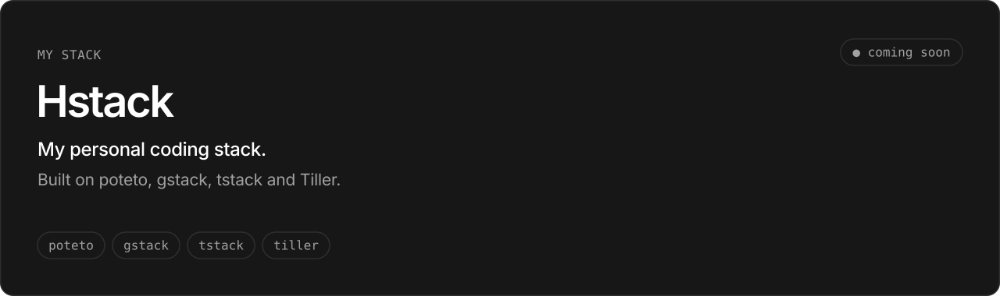
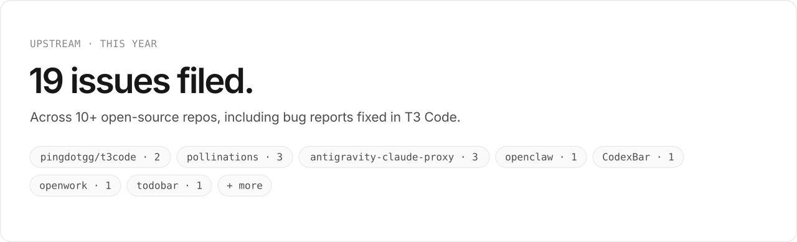

  <picture><source media="(prefers-color-scheme: dark)" srcset="assets/hero-dark.svg"></picture>

  <a href="https://hammaadjamshed.com/">hammaadjamshed.com</a> · <a href="https://tiller.shipr.app">tiller.shipr.app</a> · <a href="https://x.com/hammaadjam">@hammaadjam</a>

  <picture><source media="(prefers-color-scheme: dark)" srcset="assets/tokens-dark.svg"></picture>

  <a href="https://tiller.shipr.app"><picture><source media="(prefers-color-scheme: dark)" srcset="assets/tiller-dark.svg"></picture></a>

  <a href="https://github.com/0xNull-ops/macban-releases/releases/latest"><picture><source media="(prefers-color-scheme: dark)" srcset="assets/macban-dark.svg"></picture></a>
  <a href="https://github.com/0xNull-ops/totalaso-releases/releases/latest"><picture><source media="(prefers-color-scheme: dark)" srcset="assets/totalaso-dark.svg"></picture></a>

  <picture><source media="(prefers-color-scheme: dark)" srcset="assets/slidesmith-dark.svg"></picture>
  <a href="https://github.com/0xNull-ops/iOS-auto-deploy-and-localization"><picture><source media="(prefers-color-scheme: dark)" srcset="assets/ios-dark.svg"></picture></a>

  <picture><source media="(prefers-color-scheme: dark)" srcset="assets/hstack-dark.svg"></picture>

  <a href="https://github.com/pingdotgg/t3code/issues?q=author%3A0xNull-ops"><picture><source media="(prefers-color-scheme: dark)" srcset="assets/oss-dark.svg"></picture></a>

